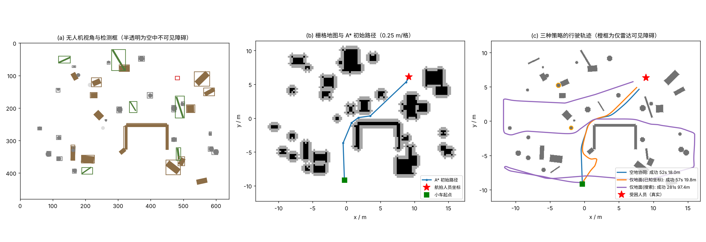

# 空地协同灾区智能搜救系统 —— 结项成果说明

本文档逐条对照立项申报书，说明每项研究内容对应的代码、验证方式与当前完成程度，供撰写结项报告、准备答辩使用。

> **重要说明**：项目实际支出约 1800 元，用于购置树莓派 5（8 GB）两套（含 500 万像素 CSI 摄像头等配件）、九轴 IMU 模块与 BMP388 气压传感器；
> 无人机机体与履带底盘尚未购置。以下凡标注“仿真验证”的结果均来自 `rescue/sim.py` 的计算机仿真，
> 不是实地测试数据，写入结项材料时请明确写“仿真”。树莓派检测程序立项初期实测（含视频保存）206 帧 / 80.0 s，平均 2.6 帧/秒；
> 立项答辩 PPT 中同一截图显示为 12.6 FPS，与原始截图不符，结项材料统一采用 2.6 帧/秒。后续在 4 GB 树莓派 5 上复测约 3.3 帧/秒，
> 优化后的帧率请用 `benchmark.py` 在树莓派上测得。

---

## 1. 研究内容与代码对照

| 申报书内容 | 实现位置 | 完成情况 |
|---|---|---|
| (1) 激光雷达 d(θ) 曲线、1 m 安全阈值、前方 120° 缝隙检测，缝隙用起始角/结束角/平均距离描述，宽度 ≥ 车宽+冗余判可通行，生成期望航向 | `rescue/lidar_gap.py` | 已实现；单元测试 + 仿真验证。另增加“车体走廊校验”，防止刮碰侧前方近距离障碍 |
| (2) YOLO11 航拍识别训练（碎石、木材、废墟、人员），数据增强 | `best_collapsed.pt`、`best_person.pt`、`yolo_examples.py` | 已完成训练并在树莓派部署；验证集召回率约 25%、mAP@0.5 约 0.25～0.28，精度待提升（见第 4 节） |
| (3) 检测框 → 栅格地图：FOV + 高度求 GSD，建立地面坐标系，四角投影，按分辨率栅格化，曼哈顿膨胀，自动选终点 | `rescue/geo_mapping.py` | 已实现；支持 IMU 俯仰/横滚补偿、气压测高公式；空中发现人员时以人员坐标为终点，否则选“障碍最少、空白最多”的前方块 |
| (3) A* 路径规划 | `rescue/planner.py` | 已实现；修正 8 邻域启发式（原脚本用曼哈顿距离会高估），禁止对角切角，输出米制路径与精简航点 |
| (4) 人体识别 + 由相机内参与安装高度估计人体距离与方位，投影到小车坐标系 | `rescue/person_locate.py` | 已实现；地面接触点法为主，身高先验法为备用（框底被图像截断时） |
| 难点(1) ONNX 中间格式、NCNN、INT8 量化，>20 FPS，连续运行 >3 小时 | `benchmark.py` | 树莓派 5 实测（`docs/raspi_tests/`）：.pt 640 → 5.12 帧/秒，.pt 320 → 15.09，NCNN 320 → 15.88（P50 63 ms，CPU 63.9 °C）；INT8 与 3 小时测试待做 |
| 难点(2) 栅格地图实时更新 >5 Hz | `geo_mapping.build_grid_map` + `drone_node.py` | 建图耗时约 5 ms/帧（PC 上测得，树莓派需复测），远高于 5 Hz 要求；单元测试 `test_grid_update_rate_over_5hz` |
| 预期成果：小车沿期望航向行驶的控制代码 | `rescue/control.py` | 纯追踪 + PID 航向控制 + 差速/履带运动学 + GPIO 电机驱动 + 脱困策略 |
| 空地通信（立项时 MQTT “yolo/test” 测试） | `rescue/comm.py` | 栅格地图按位压缩后经 MQTT 传输（约 1 KB/帧） |
| 系统集成 | `drone_node.py`、`car_node.py` | 空中端：摄像头→YOLO→地图→MQTT；地面端：收图→A*→雷达避障→电机，行驶中雷达修正地图并重规划，车载相机多帧确认人员后改道。无实物时可用 `--dry-run` 演示 |
| 空中端位姿接入（IMU + 气压计） | `rescue/baro.py`、`pose_publisher.py` | BMP388 I2C 驱动与相对测高、IMU 姿态（ROS 2 `sensor_msgs/Imu`）桥接，经 MQTT `rescue/pose` 供 `drone_node.py --pose-topic` 使用；**待实机联调** |
| 可视化与演示 | `rescue/viz.py` | 9 张功能示意图（建图、A*、缝隙检测、人员定位、控制、通信、测高、三策略对比、过程截图）与搜救过程动画（mp4/gif），示例见 `docs/figures/viz`；`--report` 输出插入 Word 用的紧凑版本 |
| 完整代码库 + 测试 | `tests/test_rescue.py` | 40 个单元测试，全部通过（算法测试只依赖 numpy；含 car_node 无硬件集成测试、BMP388 驱动模拟总线测试、可视化冒烟测试） |

## 2. 修复的原有问题

1. **原“修改后的yolo”障碍类别与模型不符**：脚本筛选 `["person","rock","tree"]`，而 `best_collapsed.pt` 唯一类别是 `collapsed`、`best_person.pt` 是 `person`，
   导致用废墟模型时地图中没有障碍物、用人员模型时把人当成障碍。现已改为：`collapsed` 等为障碍，`person` 为搜救目标。
2. **原栅格地图没有真实尺度**（20 像素 = 1 格），与申报书描述的 GSD 方法不一致。现按相机 FOV、飞行高度和姿态投影到地面，以米为单位栅格化。
3. **原 A* 8 邻域启发式不可采纳**（曼哈顿距离），路径可能非最短；现改为八方向距离。
4. **`detect_camera_cli.py` 颜色通道错误**：picamera2 的 `XRGB8888` 实际按 BGRA 存储，原代码用 `COLOR_RGB2BGR` 会把红蓝通道互换后送入模型；现改为 `COLOR_BGRA2BGR`。
   同时补上 README 中提到但未实现的 `--skip-frames`，新增 `--imgsz`、`--headless`。

## 3. 仿真实验结果

运行命令：`python -m rescue.sim --trials 30 --seed 100 --json docs/sim_results.json`（完整数据见 `docs/sim_results.json`）

**场景设置**：约 30 m × 23 m 灾区，随机生成废墟块、碎石、木材与一个 U 型死路；15% 障碍物从空中不可见（遮挡），
空中检测召回率 92%，检测框像素噪声 2 px；无人机 25 m 高度，IMU 姿态误差 0.5°、气压计高度误差 0.3 m；
小车宽 0.25 m、最大速度 0.35 m/s，360° 激光雷达量程 8 m。

### 3.1 搜救效率对比（30 个随机场景）

| 方案 | 成功率 | 中位用时 | 平均行驶距离 | 碰撞 |
|---|---|---|---|---|
| **空地协同**（航拍地图 + 航拍人员坐标） | 30/30 | **51.7 s** | 18.2 m | 0 |
| 仅地面·搜索（不知道人员位置，往返扫描） | 30/30 | 282.3 s | 93.0 m | 0 |
| 仅地面·已知坐标（理想化对照） | 29/30 | 51.8 s | 18.4 m | 0 |

- 与实际可行的“仅地面搜索”相比，空地协同用时中位数仅为其 **18.7%**（约快 5 倍）。
- 与“仅地面·已知坐标”这一理想化对照相比，两者用时接近（比值 0.99），且该对照有 1 次陷入局部死角失败。
  说明在本仿真中，空地协同的主要收益来自**空中快速发现并定位人员**，而航拍地图主要提升了路径的可靠性（避免死路）。
  答辩时如实说明这一点，比夸大“地图使路径更短”更有说服力。

### 3.2 建图精度与 IMU 姿态补偿

| 指标 | 有 IMU 姿态补偿 | 无姿态补偿（假设相机始终竖直向下） |
|---|---|---|
| 障碍栅格召回率（膨胀前） | 60.5% | 21.0% |
| 航拍人员定位误差 | 0.29 m | 1.22 m |
| 膨胀后对真实障碍的覆盖率 | 84.3% | — |
| 单帧建图耗时 | 5.3 ms（PC） | — |

剩余未覆盖的障碍主要来自“空中不可见”的 15% 障碍与漏检，由地面激光雷达在行驶中补充（`LidarMapper`），因此全部试验均无碰撞。
车载相机对人员的定位误差平均约 0.56 m。

### 3.3 识别召回率敏感性

上述仿真按航拍障碍召回率 92%、车载单帧人员召回率 90% 设置，高于当前模型的实测召回率（约 25%）。
降至 25% 后重跑同样 30 组场景（`python -m rescue.sim --trials 30 --seed 100 --recall 0.25 --car-recall 0.25`，数据见 `docs/sim_results_recall25.json`）：

| 指标 | 召回率 92%/90% | 召回率 25% |
|---|---|---|
| 空地协同成功率 / 用时中位数 | 30/30，51.7 s | 30/30，52.8 s |
| 与仅地面搜索的用时比值中位数 | 18.7% | 18.3% |
| 碰撞 | 0 | 0 |
| 航拍障碍栅格召回率（膨胀前） | 60.5% | 17.1% |
| 膨胀后障碍覆盖率 | 84.3% | 26.5% |

航拍地图漏掉的障碍由激光雷达补全，系统对障碍识别精度有一定容错；但仿真仍假设无人机能发现人员（单帧 25% 时连续 10 帧至少检出一次的概率约 94%），
人员识别召回率直接决定空地协同的收益，是模型改进的重点。

### 3.4 示例



(a) 无人机视角与检测框；(b) GSD 投影后的栅格地图与 A* 初始路径；(c) 三种方案在真实场景中的轨迹（橙框为空中不可见、只能由雷达发现的障碍）。

## 4. 建议补充的实测数据（有树莓派即可完成，无需无人机和小车）

详细的接线、命令与记录表见 [实物测试指南](实物测试指南.md)。

1. `python3 benchmark.py export --model best_person.pt --formats onnx ncnn --imgsz 320`，
   再用 `benchmark.py speed` 对比 `.pt / .onnx / ncnn` 与 640/320 输入的 FPS，形成表格（对应难点(1) >20 FPS 指标）。
2. `python3 benchmark.py soak --model best_person_ncnn_model --hours 3 --source picamera`，记录 3 小时 FPS、CPU 温度、降频情况（对应“连续运行 >3 小时”）。
3. 气压测高实测：`python3 pose_publisher.py --bmp388 --print`，带树莓派上下一层楼（或用卷尺量固定高度差），
   记录读数与真实高度差，得到 BMP388 实际测高误差（替换仿真中按手册取的 0.3 m）。
4. 手持/支架固定摄像头俯拍地面（如 2–3 m 高度拍摆放好的箱子），用卷尺量障碍物真实位置，
   与 `drone_node.py --once` 输出的地图对比，得到真实的 GSD 投影误差。
5. 两台设备（或同一台树莓派）运行 mosquitto，`drone_node.py` 发布、`car_node.py --dry-run` 接收并规划，录屏作为演示视频。
6. 若有激光雷达：`car_node.py --lidar /dev/ttyUSB0 --lidar-only` 打印实时缝隙检测结果并录屏。

## 5. 结项登记表填写参考

- 成果形式：**理科 — 作品**（未发表论文；按群通知，汇总表“成果形式”填“作品”）
- 发表刊物：无
- 有无附件：有（代码仓库、仿真结果、演示视频等）
- 汇总表：申报专项“学术专项”，学历“本科”

**结项摘要（已填入登记表，182 字）**：
针对灾区单一视角搜救效率低、通行性难判断的问题，本项目构建了空地协同智能搜救系统。空中端在树莓派上部署 YOLO11 识别废墟与人员，
结合相机视场角、飞行高度与 IMU 姿态将检测框投影为米制栅格地图；地面端以 A* 规划全局路径，并通过激光雷达缝隙检测与 PID 航向控制实现局部避障，
两端经 MQTT 通信。30 组仿真中系统成功率 100%、零碰撞，搜救用时约为纯地面搜索的 19%。

## 6. 识别模型现状与改进

两个 `.pt` 文件内保存的训练参数与最终验证指标（Ultralytics 8.4.12）：

| 模型 | 训练配置 | P | R | mAP@0.5 | mAP@0.5:0.95 |
|---|---|---|---|---|---|
| `best_collapsed.pt` | `yolo11n.yaml` 从零训练，100 epoch，640，batch 16，SGD | 0.399 | 0.255 | 0.248 | 0.130 |
| `best_person.pt` | 同上 | 0.837 | 0.248 | 0.281 | 0.163 |

发现的问题：`pretrained=False`（未加载预训练权重）；`val=False`（训练中不做验证，best.pt 即最后一轮）；
人员数据集 `names` 中有两个同名 `person` 类别。建议重新训练：

```bash
# 在 data.yaml 中把人员数据集合并为 nc: 1, names: ['person']（标签中的类别 1 改为 0）
yolo detect train model=yolo11n.pt data=<数据集>/data.yaml epochs=100 imgsz=640 batch=16
yolo detect val model=runs/detect/train/weights/best.pt data=<数据集>/data.yaml
```

`model=yolo11n.pt` 会加载 COCO 预训练特征，并按 data.yaml 的类别数重建检测头，模型只输出自己的类别。
报告图 4-1 用验证集图片生成：`python3 yolo_examples.py --collapsed <collapsed验证集>/images --person <person验证集>/images --pick 1`。

